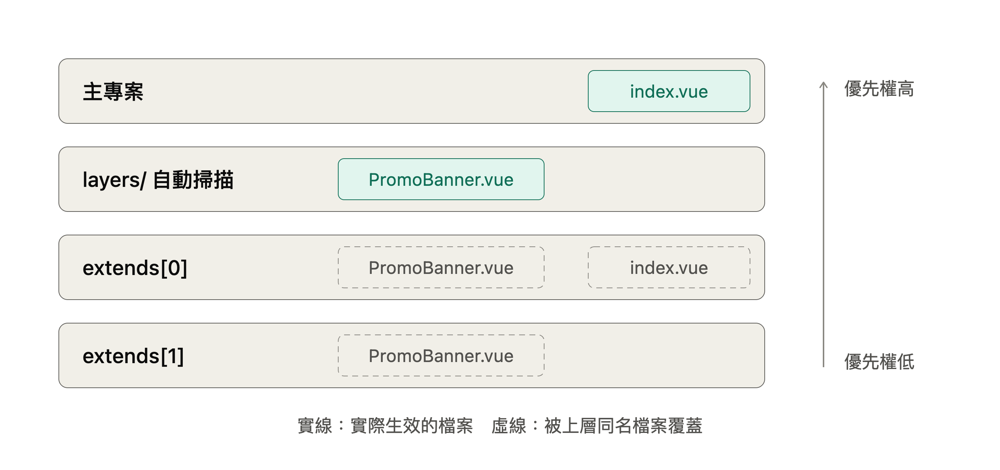

# Nuxt Layer Repo

這是一個測試Nuxt4的遠端組件專案

使用[nuxt4 layers](https://nuxt.com/docs/4.x/guide/going-further/layers) 的規則將組件放在此，讓主要的[repo](https://github.com/daivdyang/nuxt4-layer-parent.git)去加載此repo的組件，達到組件與組件之間的隔離。

## 專案說明

依據 nuxt4 文件規則

## 建立方式

建立 layer 專案最快的方式是用官方的 layer 範本。至於 `nuxt` 本身，需要安裝，但要放在 `devDependencies`（並建議宣告為 `peerDependencies`），不要放在 `dependencies`。

為什麼 nuxt 放 `devDependencies`，不放 `dependencies`？ 開發 layer 時需要 nuxt 來跑 `playground`、產生型別、做 `typecheck`，所以一定要裝。但 layer `最終是被主專案引用的`，`執行它的是主專案的 nuxt`。如果放在 `dependencies`，使用者`安裝時可能會多裝一份`不同版本的 nuxt，造成型別錯亂或 build 時抓到兩套 Vue。`peerDependencies` 則用來告訴使用者「這個 layer 需要 Nuxt 4」，版本不符時套件管理器會發出警告。

Layer 用到的 `module` 和套件要放 `dependencies`，例如 `PrimeVue`。這些套件是主專案 build 時真正需要的，必須跟著 layer 一起被安裝。

練習用，故手動建立此專案，流程如下：

1. 建立組件資料夾與本地測試用的.playground資料夾，安裝依賴的套件

    ```
    // bash

    npm init -y
    npm i -D nuxt typescript vue-tsc  # 安裝相依的庫，也就是外部專案也會有的依賴，-D表示放在devDependencies（使用此組件的外部專案會提供），若有本組件需要的函式庫且外部專案可能不會提供，那就需要安裝到dependencies
    mkdir -p app/components .playground  # .playground是用來在dev時檢視用，提供給外部專案用的組件會放在app/components之下
    ```

2. 配置 `package.json`

    範例：
    ```json
    {
        "name": "@your-org/ui-layer",
        "version": "1.0.0",
        "type": "module",
        "main": "./nuxt.config.ts", // main 指向 nuxt.config.ts，這樣主專案寫 extends: ['@your-org/ui-layer'] 時，c12 才找得到設定檔。
        "files": [ // 要列出所有要發佈的目錄。Layer 發佈的是原始碼，不需要 build 步驟；但漏列目錄就等於那部分不存在。.playground 不要列進去。
            "app",
            "server",
            "shared",
            "i18n",
            "nuxt.config.ts",
            "app.config.ts"
        ],
        "scripts": {
            "dev": "nuxt dev .playground", // 本機測試時，使用.playground目錄下的nuxt.config.ts來建置
            "build": "nuxt build .playground",
            "postinstall": "nuxt prepare",
            "typecheck": "nuxt typecheck"
        },
        "peerDependencies": {
            "nuxt": "^4.0.0". // 用來告訴使用者「這個 layer 需要 Nuxt 4」
        },
        "dependencies": {
            "@primevue/nuxt-module": "^4.x",
            "primevue": "^4.x"
        },
        "devDependencies": {
            "nuxt": "^4.x",
            "typescript": "^5.x",
            "vue-tsc": "^2.x"
        }
    }
    ```

3. 配置 root 層的 nuxt.config.ts 並設定 extends ，這是 Nuxt Layers（層） 機制的入口，可以把此nuxt專案當作「底層」，讓外部的專案載入後當作「底層元件庫」，Nuxt 啟動時會把所有layer的設定和目錄內容合併成一個應用程式
   
   ```javascript
    export default defineNuxtConfig({
        extends: [
            // 入口點： ..表示當前檔案的目錄的上一層目錄（不是指檔案本身）
            // 例如.playground/nuxt.config.ts內的..指的是.playground目錄的上一層，也就是readme.md那一層的目錄
            '..'
        ],
        // 只放「測試時才需要」的設定，例如 devtools、eslint
        devtools: { enabled: true }
    })
   ```
4. 開始

## Layer的概念說明

### Layer 到底是什麼

一個 layer 就是一個「不完整的 Nuxt 專案」。它有自己的 `nuxt.config.ts`，並且可以有 `app/components`、`app/pages`、`server/`、`public/` 等任何 Nuxt 認得的目錄。它不需要能獨立跑起來，只需要能被別人疊上去。

Layer 和兩個相近的東西的差別在於：npm 元件庫只提供元件，你要自己 `import` 和註冊；Nuxt `module` 是用程式碼去「改寫」Nuxt 的 build 流程（hooks、addComponent 等）。Layer 則是`以檔案慣例為基礎的合併`：你照 Nuxt 的目錄規則放檔案，Nuxt 就把它當成自己的檔案處理。一個 layer 裡也可以安裝和設定 modules，所以通常是「layer 包著 modules」的關係。

### 合併在什麼時候、怎麼發生

Nuxt 啟動（dev 或 build）時，會用 `c12` 這個套件載入主專案的 `nuxt.config.ts`。它一看到 `extends`，就去取得那些 layer（本地路徑、npm 套件，或用 `giget` 從 `GitHub`、`GitLab` 下載），然後遞迴處理。因為 layer 自己也可以 `extends` 別的 layer，最後會得到一個排好順序的 layer 清單，存在 `nuxt.options._layers`。

### 接下來會發生兩件事：

設定合併：所有 `nuxt.config` 用 `defu` 做深度合併。物件逐層合併、上層的值優先；陣列（例如 modules、css）則是串接。所以 layer 裝的 module 和主專案裝的 module 會一起生效。

目錄掃描：Nuxt 掃描元件、composables、pages 等目錄時，會把每個 layer 的對應目錄都掃一遍，再依優先順序處理同名衝突。

各類內容的合併規則不太一樣：


| 內容 | 合併方式 |
| -- | -- |
| nuxt.config.ts、runtimeConfig	| 深度合併，上層優先；陣列串接 |
| app.config.ts | 執行時深度合併，上層優先（適合放主題、可覆寫的預設值）|
| components、composables、utils | 同名者上層覆蓋，其餘全部註冊 |
| pages	| 同路徑者上層覆蓋，可以只讓 layer 提供部分頁面 |
| layouts、具名 middleware | 同名覆蓋 |
| plugins | 全部載入，不互相覆蓋；layer 的 plugin 先於主專案執行 |
| server/（api、routes、middleware）| 同路由覆蓋，其餘合併 |
| public/ | 同路徑檔案覆蓋 |
| shared/utils、shared/types | 自動匯入，和 components 一樣合併 |

### 優先順序



如上圖所示，優先權由高到低是：主專案、`layers/` 目錄中自動掃描到的 layer、extends 陣列中的 layer（排越前面越高）。

`layers/` 目錄裡的 layer 依字母順序排序，後面的字母優先權較高。如果要明確控制順序，官方建議用數字前綴命名，例如 `layers/1.base`、`layers/2.theme`。這些自動掃描的 layer 也會產生別名，例如 `#layers/base`。

#### Layer 內的路徑：最常踩的坑

Layer 的程式碼是在主專案的環境裡被編譯的，所以「相對於誰」很重要：

- 元件或 composables 裡寫的 `~/`、`@/`，會指向主專案，不是 layer 本身。Layer 內部請用相對路徑。
- Layer 的 `nuxt.config.ts` 裡如果有指向檔案的設定（例如 css），也要轉成絕對路徑，不要直接寫字串：

```typescript
// ui-layer/nuxt.config.ts
import { createResolver } from '@nuxt/kit'

const { resolve } = createResolver(import.meta.url)

export default defineNuxtConfig({
  css: [resolve('./app/assets/css/base.css')],
})
```

### 依賴管理

Layer 用到的套件（例如 `PrimeVue`）要寫在 layer 的 `dependencies`，主專案安裝 layer 時才會一併裝到。用 Git 遠端 layer 時，要開 `install: true` 才會安裝它的依賴。如果主專案和 layer 都依賴同一個套件，建議其中一方用 `peerDependencies`，避免裝到兩個版本，像 `Vue` 或 `PrimeVue` 這類有單例狀態的套件尤其要注意。

### 常見的架構用法

Base layer：放共用的 PrimeVue 主題、Tailwind 設定、i18n 基礎設定與四種語系的共用翻譯、API client composables、驗證 middleware。所有前台專案都 extend 它。

Feature layer：把一塊完整功能（例如遊戲大廳或錢包相關頁面）連同它的 pages、components、server routes 一起打包。需要的專案才 extend，不需要的就不引入。

多品牌／白標：每個品牌是一個很薄的主專案，只 extend base layer，再透過 app.config.ts 換主題色與 logo，並用同名元件覆蓋少數需要客製的地方。這是 layer 覆蓋機制最能發揮的情境。

在 monorepo 裡，通常會是 `apps/*`（各個主專案）加上 `layers/*`（共用 layer），用本地路徑或 workspace 套件引用。這樣修改 layer 時可以馬上在各 app 看到效果，不必發版。

### 限制

Layer 是在 `build time` 合併的，產出的是一個單一的應用。所以它沒有執行時隔離：所有 layer 共用同一個 Vue app、同一個 Pinia、同一套路由。Layer 更新後，每個使用它的專案都必須重新 build 和部署。另外，覆蓋是以「整個檔案」為單位，沒辦法只改元件的一小段；要做細部客製，比較好的方式是 layer 元件本身提供 props、slots 或 app.config 選項。

### 需要注意的地方

別名 `~` `/` `@` 的陷阱：在 `layer` 的元件或 `composable` 裡寫 `~/xxx`，會被解析到「主專案」的路徑，而不是 `layer` 自己的。Layer 內部請改用`相對路徑`，或用`具名別名` `#layers/ui/...`（對應上面設定的 $meta.name）。


`Tailwind` 掃描：Tailwind 必須能掃到 layer 裡的 class，否則樣式會被 purge 掉。
- 使用 `@nuxtjs/tailwindcss` 模組時，它會自動包含 layer 目錄。
- 使用 Tailwind v4（@tailwindcss/vite）時，要在主 CSS 手動加上 `@source`，例如：

    ```css
    @import "tailwindcss";
    @source "../../../node_modules/@your-org/ui-layer/app";
    ```

- Git 遠端 layer 會下載到 node_modules/.c12/ 底下，路徑比較不固定。建議 UI layer 用 npm 私有套件發佈的原因之一。

`18n`：`@nuxtjs/i18n` 支援 layer，layer 裡 i18n 設定的 locale 檔會和主專案合併，相同 key 以主專案為準。所以 layer 可以自帶繁中、韓、泰、英的預設翻譯，主專案只覆寫需要改的部分。

`PrimeVue`：建議只在其中一處（主專案或 layer）註冊 @primevue/nuxt-module 和主題，避免重複設定造成 preset 互相覆蓋。

`版本與快取`：Git 遠端 layer 每次 build 都會重新下載，請務必鎖定 tag 或 commit。CI 環境也要提供 GITHUB_TOKEN。

`更新方式`：Layer 是 build time 合併的，遠端更新後主應用必須重新 build、部署才會生效。如果需要「不重新部署就更新元件」，那就要使用 `remote island` 或 `Module Federation` 的方案。

`組件ts型別`：確保會執行 prepare。建議加在 `postinstall`，剛 clone 或 CI 上才不會缺型別：

```json
 { "scripts": { "postinstall": "nuxt prepare" } }
```

Git 遠端 layer 在 prepare 階段就會下載，所以 CI 執行 install 時就需要 GITHUB_TOKEN。

### 自訂的 interface / type 要怎麼共用

元件與 `composables` 會自動有型別，但 layer 裡自己定義的 `interface`（例如 PromoItem）預設不會在主專案出現，需要另外處理。有三種做法，依推薦程度排列：

1. 放在 layer 的 `shared/types/`：`Nuxt 4` 會自動匯入這個目錄的型別，layer 也適用。

    例如：
    ```typescript
    // root/shared/types/promo.ts
    export interface PromoItem {
    id: string
    title: string
    locale: 'zh-TW' | 'ko' | 'th' | 'en'
    }
    ```

    在主專案裡可以直接使用 `PromoItem`，不必 `import`。

2. 用具名 layer 別名明確匯入，對應前面 `$meta: { name: 'ui' }` 的設定：

    ```typescript
    import type { PromoItem } from '#layers/ui/shared/types/promo'
    ```

3. npm 套件形式時用 package exports：

    packages.json (export)
    ```json
    { "exports": { ".": "./nuxt.config.ts", "./types": "./shared/types/index.ts" } }
    ```

    (import)
    ```typescript
    import type { PromoItem } from '@your-org/ui-layer/types'
    ```